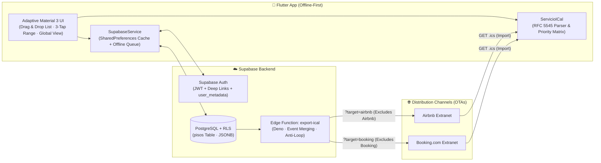

# 🏠 Flat Booking Calendar — Mobile Channel Manager & Multi-Property Calendar

[](https://github.com/odeily/Flat-Booking-Calendar/actions/workflows/ci.yml)
[](https://flutter.dev)
[](https://dart.dev)
[](https://supabase.com)
[](https://datatracker.ietf.org/doc/html/rfc5545)
[](LICENSE)

An **Offline-First** mobile Channel Manager built with **Flutter** and **Supabase** for managing short-term rental portfolios and performing loop-free, bidirectional **iCalendar (RFC 5545)** availability synchronization across **Airbnb** and **Booking.com**.

---

## 🎯 The Engineering Problem It Solves

Managing vacation rentals across multiple Online Travel Agencies (OTAs) without expensive third-party SaaS Channel Managers exposes hosts to three classic production failure modes when linking `.ics` calendars directly:

1. **False Overbooking Alerts from Privacy-Redacted Cross-Blocks**: Due to GDPR/privacy defaults, Airbnb and Booking export generic summaries (`CLOSED - Not available` or `Airbnb (Not available)`). When a host blocks dates on Booking for an existing Airbnb stay, naive iCal parsers misclassify the mirror block as a conflicting reservation.
2. **Sync Echo Loops**: If an OTA imports a consolidated calendar feed containing its own reservations, it re-imports its own bookings as permanent availability blocks—preventing dates from reopening even after a guest cancels.
3. **Guest Identity Loss Across Re-Syncs**: When a property manager replaces a generic OTA placeholder (`"Reservado #HM..."`) with the guest's actual name, naive sync engines either overwrite the custom name on the next refresh or fail to detect when that booking was cancelled and replaced by a *different* reservation on the exact same dates.

**Calendario Pisos** solves all three problems through a deterministic **Strict Priority Matrix**, **target-segmented Edge Function feeds**, and **composite reservation identity tracking (`UID` + Confirmation Code)**.

---

## 🏗️ System Architecture



---

## ✨ Key Engineering Highlights

### 1. RFC 5545 Channel Manager Engine (`ServicioICal`)
* **Strict Priority Matrix (`Verified Booking > External Block`)**: Automatically distinguishes verified stays (presence of `Confirmation Code`, `Reservation URL`, or non-generic `SUMMARY`) from generic availability closures (`CLOSED`, `Not available`). When an OTA sends a mirror block over a verified stay from another channel, the verified booking retains ownership and records a cross-channel protection badge without triggering false conflict dialogs.
* **True Overbooking Detection & Resolution**: Raises a critical alert—paired with a day-by-day interactive resolution wizard—exclusively when two verified `reservaReal` stays from *different* channels collide on the same night.
* **Stateful Guest Name Preservation**: Tracks reservation identity via confirmation codes and `UID`s. Custom guest names assigned by the host survive subsequent syncs—even when a stay is extended, shortened, or shifted to new dates on the OTA—while automatically resetting to a `"Reservado"` alert if the original booking is cancelled and replaced by a new guest.
* **Production-Hardened RFC 5545 Compliance**: Handles 75-octet *line unfolding* (`CRLF` + whitespace), `webcal://` scheme normalization (Safari/iOS), resilient raw-byte UTF-8 decoding (preventing mojibake when servers omit `charset=utf-8` on `Content-Type: text/calendar`), and historical past immutability.

### 2. Loop-Free `export-ical` Edge Function
* **Contiguous Night Compaction (*Event Merging*)**: Sweeps chronologically sorted nights and merges adjacent dates belonging to the same stay into a single `VEVENT` block with inclusive `DTSTART;VALUE=DATE` and exclusive `DTEND;VALUE=DATE`.
* **Channel-Segmented Anti-Loop Feeds**:
  * `/export-ical/<id>_airbnb.ics?piso_id=<id>&target=airbnb` → Excludes Airbnb-originated stays so Airbnb only imports Booking and manual reservations.
  * `/export-ical/<id>_booking.ics?piso_id=<id>&target=booking` → Excludes Booking-originated stays.
  * `/export-ical/<id>.ics?piso_id=<id>` → Exports the full consolidated schedule for personal calendars (Google Calendar, Apple Calendar).
* Supports `HEAD` and `GET` extranet pre-validation probes and strictly valid 0-event empty calendars (omitting `METHOD:PUBLISH` per RFC 5545/5546).

### 3. Offline-First Persistence & Mobile-First UX
* **Write-Ahead Offline Queue**: Reads and writes resolve instantaneously against local cache (`SharedPreferences`), queuing mutations offline and reconciling temporary `local_*` IDs with PostgreSQL UUIDs automatically upon reconnection.
* **Tactile Mobile Workflows**:
  * **Long-Press Drag-and-Drop Reordering** on the property portfolio list, synced across devices via Supabase `user_metadata`.
  * **3-Tap Date Range Selector** (check-in → check-out → reset) and whole-stay rename/release actions triggered from any single night of a multi-night booking.
  * **Multi-Property Global Calendar** with responsive switching between *Mobile Daily Agenda* and *Stacked Continuous Bars*.

---

## 📂 Project Structure

```text
├── .github/workflows/ci.yml           # Automated GitHub Actions CI (flutter analyze + flutter test)
├── assets/                            # App branding and embedded legal documents
├── docs/
│   └── ARQUITECTURA_TECNICA.md        # Detailed technical architecture specification (ES)
├── lib/
│   ├── main.dart                      # App bootstrap, Auth stream / Offline Demo routing
│   ├── core/
│   │   ├── config/app_config.dart     # Compile-time environment config (--dart-define-from-file)
│   │   ├── constants/app_colors.dart  # Exclusive OTA brand colors & deterministic manual palette
│   │   └── theme/app_theme.dart       # Material 3 Design System (Light & Dark themes)
│   ├── models/                        # Immutable domain entities, sync DTOs & JSON serialization
│   ├── services/
│   │   ├── servicio_ical.dart         # RFC 5545 parser, priority matrix & channel reconciliation
│   │   └── supabase_service.dart      # Offline-First repository (PostgreSQL + local cache/queue)
│   ├── screens/                       # Responsive mobile & desktop feature screens
│   └── widgets/                       # Reusable UI components, bidirectional sync sheet & guide
├── scripts/
│   └── build_apk.sh                   # Release APK packaging script with env injection
├── supabase/
│   ├── functions/export-ical/index.ts # Deno/TypeScript Edge Function for RFC 5545 export
│   └── migrations/                    # PostgreSQL DDL, Row Level Security (RLS) & GDPR RPC
├── test/
│   ├── ical_priority_and_ui_test.dart # Unit & widget tests for RFC 5545 priority rules and UI
│   └── stress_sincronizacion_test.dart# Exhaustive stress suite, OTA mutations & mobile E2E flows
└── env.example.json                   # Public template for compile-time environment variables
```

---

## 🚀 Getting Started

### Option A: Instant Offline Demo Mode (Zero Configuration)
Reviewers can clone and run the full application immediately—creating and reordering properties, selecting date ranges, inspecting the multi-property calendar, and testing iCal imports—backed by local storage without needing a Supabase account:

```bash
git clone https://github.com/odeily/Flat-Booking-Calendar.git
cd Flat-Booking-Calendar
flutter pub get
flutter run
```

### Option B: Full Cloud Setup with Supabase
1. Create a project on [Supabase](https://supabase.com) and run the SQL migration in [`supabase/migrations/20260901000000_initial_schema.sql`](supabase/migrations/20260901000000_initial_schema.sql) via the *SQL Editor* to provision the `pisos` table, RLS policies, and account deletion RPC.
2. Deploy the public `export-ical` Edge Function:
   ```bash
   npx supabase functions deploy export-ical --project-ref <your-project-ref> --no-verify-jwt
   ```
3. Copy the environment template and fill in your Supabase URL and publishable key:
   ```bash
   cp env.example.json env.json
   ```
4. Launch in development or build a production Android `.apk`:
   ```bash
   # Run on a connected device or emulator with cloud sync enabled
   flutter run --dart-define-from-file=env.json

   # Build a release APK into releases/
   ./scripts/build_apk.sh
   ```

---

## 🧪 Static Analysis & Automated Testing

The repository includes **33 automated tests** covering RFC 5545 unfolding, priority matrix quadrants, guest identity persistence across OTA modifications, network failure resilience, UTF-8 byte decoding, and 60fps mobile gesture E2E flows:

```bash
# Strict static analysis (zero warnings / zero infos)
flutter analyze --fatal-infos

# Run all unit, stress, and mobile widget test suites
flutter test
```

---

## 📖 Additional Documentation & License

* Detailed technical specification (in Spanish): [`docs/ARQUITECTURA_TECNICA.md`](docs/ARQUITECTURA_TECNICA.md)
* Distributed under the **MIT License**. See [`LICENSE`](LICENSE) for details.
